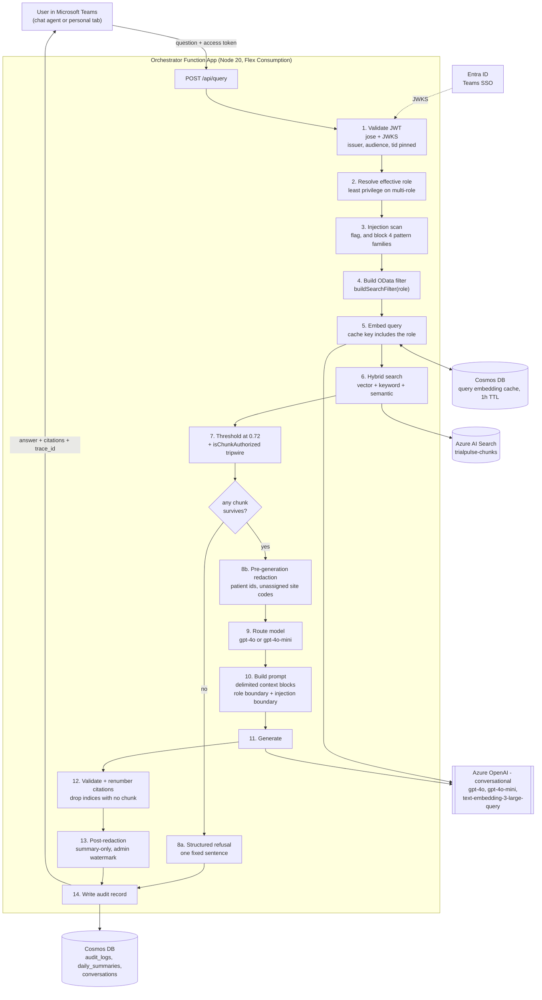
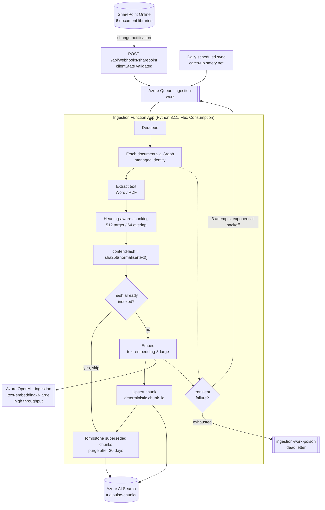

# TrialPulse architecture

## What the system is

TrialPulse answers natural-language questions about Meridian's clinical document
corpus inside Microsoft Teams, with a citation for every claim and a hard access
boundary enforced at the search engine rather than in application code.

Two independent paths, deliberately decoupled:

- The **query path** is synchronous and latency-sensitive. A user asks; the
  orchestrator authenticates, builds a role-scoped filter, searches, thresholds,
  generates a cited answer, redacts, audits, and returns. Target P50 under 2s,
  P99 under 5s.
- The **ingestion path** is asynchronous and throughput-sensitive. SharePoint
  changes enqueue work; a Python pipeline extracts, chunks, hashes, embeds and
  indexes. An ingestion failure does not affect query availability (PRD 8.3).

They share exactly one thing: the Azure AI Search index. They do not share an
Azure OpenAI account (ADR 0005), a managed identity, or a rate-limit surface.

## Query path

The ordering is not arbitrary. **Authentication precedes role resolution
precedes filter construction precedes retrieval.** There is no point in the flow
where a chunk exists in memory that the caller was not entitled to - which is
what makes the "post-filter" alternative (ADR 0001) structurally different rather
than just stylistically different.

Two steps that are easy to overlook:

- **Step 7's tripwire.** `isChunkAuthorized` re-checks every returned chunk
  against the role policy. It should never fire. If it does, the filter has a bug
  and the audit record says `no_authorized_documents` while the user sees an
  ordinary refusal.
- **Step 8b happens before generation, not after.** Patient identifiers and
  unassigned site codes are removed from the context text the model receives. The
  model is never shown an identifier and asked not to repeat it.

## Ingestion path

The content hash is the load-bearing element. It makes the whole pipeline
idempotent, which is what lets both an unreliable webhook and a brute-force daily
sync feed the same queue without duplicating chunks or re-spending on embeddings
(ADR 0003).

## Components

### Teams surfaces

**Declarative agent** for 1:1 and channel chat. **Personal tab** (React + Vite)
with three views: Ask (chat with conversation history), Browse (document library
filtered to the caller's role, with ingestion status), Dashboard (usage and
cost). The tab acquires an Entra token through Teams SSO and calls `POST /api/query`,
routing all requests through the orchestrator's role filter, redaction pipeline, injection
scanner, citation validator and audit trail. The declarative agent grounds directly on
Microsoft Graph / SharePoint search under the user's own permissions, bypassing these controls
entirely — see `teams/declarative-agent/instructions.md` and teams README "Known limitation".

The tab renders `CitedAnswerCard`, `RefusalCard`, `RedactionNotice`,
`DocumentStatusBadge`, `RoleBadge` and `CostDashboard`. `RoleBadge` matters
operationally: because a multi-role token resolves to the *least* privileged role
(ADR 0002), a user needs to be able to see what they are searching as.

### Orchestrator (`packages/orchestrator`)

TypeScript on Node 20, Azure Functions Flex Consumption, system-assigned managed
identity. Every external dependency sits behind an interface in
`src/providers/types.ts`, with an Azure implementation in `src/providers/azure/`
and a deterministic in-memory implementation in `src/providers/memory/`. That
split is what makes the repository runnable and the eval suite reproducible with
no Azure at all (ADR 0007).

Pipeline modules, each independently testable:
`auth/jwt.ts`, `pipeline/refusal.ts`, `pipeline/redaction.ts`,
`pipeline/model-router.ts`, `pipeline/prompt.ts`, `pipeline/citations.ts`,
`pipeline/circuit-breaker.ts`, `pipeline/version-compare.ts`.

### Shared contract (`packages/shared`)

The types, RBAC policy, constants, cost table, hashing and injection heuristics
that the orchestrator, the Teams tab and the eval harness all depend on. Changing
anything here is a breaking change for every workstream, which is the intended
friction.

`rbac.ts` is the security-critical file in the repository. It holds
`ROLE_POLICIES`, `resolveRole`, `buildSearchFilter` and `isChunkAuthorized`.

### Ingestion (`ingestion/`)

Python 3.11 on Flex Consumption, system-assigned managed identity. Owns the
index schema (`ingestion/schema/search-index.json`) and creates the index out of
band - which is why the ingestion identity holds `Search Service Contributor`
scoped to the one search service.

`hashing.py` mirrors `packages/shared/src/hash.ts` exactly.
`tests/test_hash_parity.py` is the only thing preventing the two from drifting,
and drift means every document re-ingests on the next sync.

### Data stores

| Store | Holds | Notable configuration |
|---|---|---|
| Azure AI Search | chunks + 3,072-dim vectors | `disableLocalAuth`, `document_classification` filterable, HNSW |
| Cosmos DB | `audit_logs` (`/partition_date`), `daily_summaries` (`/date`), `conversations` (`/conversation_id`, 30-day TTL), `cache_entries` (`/id`, per-item TTL) | `disableLocalAuth`, continuous backup, **no TTL on `audit_logs`** |
| Storage | ingestion queue + poison queue, deployment package, audit archive | `allowSharedKeyAccess: false`, lifecycle to Archive at 90d, delete at 7y |
| Cache (`cache_entries` Cosmos container) | 1-hour TTL embedding cache, role-scoped keys (`emb:<role>:<sha256>`) | on existing Cosmos DB account, TTL enabled |
| Key Vault | exactly one secret | RBAC authorisation, versionless references |

`audit_logs` having TTL switched off entirely - rather than set to `-1` - is
deliberate: a stray per-item `ttl` field must not be able to expire a compliance
record. `cache_entries` is the opposite case and uses `-1` precisely so that
per-item TTL works.

### The query embedding cache

PRD section 9 recommends Azure Cache for Redis. The orchestrator uses a Cosmos DB
container instead, with the same `CacheProvider` interface
(`packages/orchestrator/src/providers/types.ts`). Cosmos is already required for
the audit log and conversation history, and its native per-item `ttl` field maps
exactly onto the cache interface. Redis has been removed entirely (no
`redis.bicep`, no idle $16/month spend).

The decision — rationale, tradeoffs and reversibility — is documented in
`docs/adr/0008-embedding-cache-store.md`. Cache keys are role-scoped
(`emb:<role>:<sha256>`) so no entry can be served across a role boundary;
see ADR 0001.

### Identity and authorisation

Users authenticate with Entra ID; roles come from the `roles` claim and there is
no local role store. Services authenticate with managed identity: local auth is
disabled on Azure OpenAI, Azure AI Search and Cosmos DB, and shared-key access is
disabled on Storage. Every role assignment is in `infra/modules/rbac.bicep`,
scoped to one resource, with no Owner or Contributor anywhere.

The two Azure OpenAI accounts are an authorisation boundary as much as a capacity
boundary: the ingestion identity holds no role on the conversational account and
therefore cannot call a generation model at all.

### Observability

OpenTelemetry spans to Application Insights (workspace-based), with the
`trace_id` joining the response, the audit record and the spans. Diagnostic
settings on all ten applicable resources route to one Log Analytics workspace
with a daily ingestion cap. Three scheduled query rules cover P99 latency, error
rate and rolling 24-hour model spend, plus an Azure Consumption budget on the
resource group.

## Deployment topology

One subscription, one resource group per environment, one region (`eastus`,
parameterised). `infra/main.bicep` is subscription-scoped and creates the group.
Names carry a deterministic `uniqueString` suffix so a redeploy updates rather
than duplicates. Every resource is tagged `app`, `env`, `owner`, `costCenter`,
`dataClassification`.

All services are on public endpoints with authentication. Private Endpoints and
VNet integration are the obvious next hardening step and are not implemented -
see `threat-model.md`.

## What is deliberately not here

- **No API gateway.** Azure Functions handles HTTP directly. That means no
  per-user rate limiting, which is a known gap (threat model D1).
- **No separate role or user database.** Entra is authoritative.
- **No Power BI workspace.** PRD section 2.1 offers "Power BI embedded *or* Teams
  tab"; the Teams tab Dashboard is the implementation.
- **No multi-region failover.** Single region, per ADR 0006. PRD's 99.9% target is
  achievable single-region on paper; 99.99% would not be.
- **No document-level ACL propagation from SharePoint.** Access is decided by
  `document_classification`, not by the SharePoint item's own permissions. If a
  document's SharePoint ACL is narrower than its classification implies,
  TrialPulse is more permissive than SharePoint. That is a real modelling gap and
  it belongs on the go-live discussion with Meridian.
